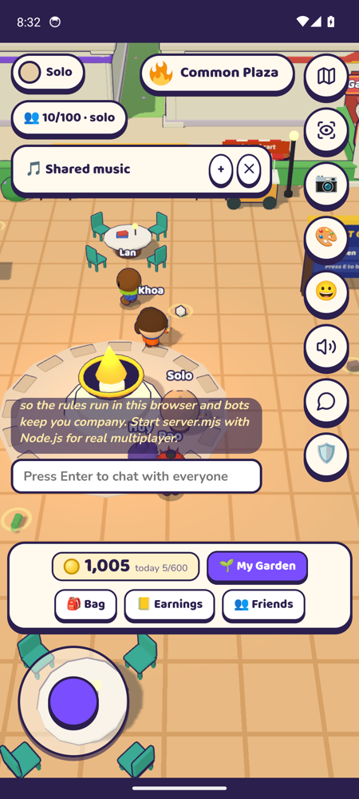

# Common Area

**Common Area is a 3D online plaza where a class or a group of friends study, play and hang out together.** You open a link, pick a character and walk into a shared space. Sitting at a table with others earns Xu for focused study time, and each 25-minute round ends with a short quiz. Xu pays for a private garden island with crops, animals and a house you decorate. Around the plaza are a cinema with a shared video queue, a game room (Ludo, Colour Cards, Werewolf, Colour Match), an astrology room and a quiet forest for fishing. Players add each other as friends and visit each other's gardens. It runs in any browser and as an Android app.

| | |
|---|---|
| **Play now** | https://common-area.onrender.com (the free server sleeps when idle, so the first load can take up to a minute) |
| **Android app** | [android/release/CommonArea-1.0.apk](android/release/CommonArea-1.0.apk) (Android 8.0 or newer) |
| **Demo video** | [docs/demo.mp4](docs/demo.mp4) (2 min 37 s: enter, study, play, friends, garden, forest) |
| **Tracking plan** | [TRACKING.md](TRACKING.md) |



## The product

### The problem

Studying online with other people usually means a video call (tiring, camera on, nothing to do but stare) or a chat server (text only, easy to drift away from). A group ends up spread over several tools: one for the call, one for music, one for a game during the break. There is no place that feels like sitting in the same room, where showing up and staying focused is visible and rewarded, and where the break activities are a few steps away.

### Target users

- **Students and study groups**: classmates, clubs and friend groups, roughly 16 to 25, who already study "together" over chat or calls.
- **First market: Vietnam.** The plaza has a bánh mì cart, the currency is Xu, and the astrology room includes Tử Vi next to numerology and a western chart. The interface is in English.
- A group needs no account and no install: one person shares the link.

### Core features

- **Study together.** Sit at a table in the plaza, the meeting room or the forest and earn Xu per focused minute. After 25 minutes a Pomodoro quiz appears; a right answer pays a bonus. Food and drinks from the carts give a study boost.
- **A garden worth coming back to.** Each player has a private island: fields, an orchard, a fish tank, cloud flower gardens, pens for chickens, pigs and cows, and a two-storey house to furnish. Plants grow in real time.
- **Friends.** Click a player to send a friend request. The Friends panel shows who is online and takes you to a friend's garden, also when they are offline. Likes pay the garden's owner.
- **Game Room.** Shared tables for Ludo, Colour Cards and Werewolf with a server referee, a turn clock, spectators and table chat, plus Colour Match (30 levels) for one player. Computer players fill empty seats for practice.
- **Cinema and Music Corner.** A shared YouTube queue; everyone in the room watches or hears the same thing at the same moment.
- **Astrology Room.** One birth form gives three readings: numerology, a western chart and Tử Vi.
- **Quiet Forest.** Fishing chairs, a playground, a café, local-only chat and +25% study Xu.
- **Your own character.** A picture-based customizer, emotes, and outfits.
- **Closed rooms.** You only see and hear a room after walking in, like a real building.

### Launch channel

- **The web link is the launch.** The game is live at https://common-area.onrender.com. Nothing to install and no account, so a link dropped into a class or club group chat is enough to bring a group in together.
- **The Android app** (`android/`) puts the same game on a phone's home screen. It is shared as an APK file for now; the Play Store is the next step.
- Launch order: our own class and the Apero programme first, then student clubs and study communities.

### How it gets users, and revenue

- **Users come in groups.** Every feature is better with company, so each player has a reason to invite others: table games need 2 to 10 people, the cinema and music queue are shared, and the friends list and garden visits pull people back to see what changed. The weekly "Best Garden" and "Best Fish Tank" boards give a reason to show off.
- **We measure it.** `session_start` records whether a visit came from the website or the Android app, and the funnel in [TRACKING.md](TRACKING.md) runs from first visit to first friendship.
- **Revenue: none today.** The game is free and has no ads. The plan is cosmetic sales that never affect study rewards (outfits, house and garden decoration packs) and paid private plazas for classes, clubs and tutoring centres (own link, own quiz bank, saved progress). The `shop_buy` event already shows what players choose to spend Xu on, which tells us what would be worth selling.

## Build, run or access

**Play online:** https://common-area.onrender.com

**Android:** install [android/release/CommonArea-1.0.apk](android/release/CommonArea-1.0.apk) (allow "install unknown apps" when asked). The app opens the live game and falls back to a built-in solo copy when there is no internet.

**Run it on your computer, solo** (nothing to install; computer villagers keep you company):

```bash
python3 serve.py
```

**Run the multiplayer server** (Node.js 18 or newer, no `npm install`):

```bash
ADMIN_PASSWORD=choose-one node server.mjs
```

Then open http://localhost:5173. Statistics are at http://localhost:5173/stats.html (admin password).

**Run the tests** (Node.js 22 or newer):

```bash
node tests/rules.test.mjs && node tests/games.test.mjs && node tests/match.test.mjs && node tests/tracking.test.mjs
```

```bash
node tests/astro.test.mjs && node tests/reading.test.mjs && node tests/text/all.check.mjs && node --test tests/F*.test.js
```

**Build the Android app:** `bash android/build.sh` (see [android/README.txt](android/README.txt) for the tools it needs).

**Publish:** the repository is a Render Blueprint (`render.yaml`). Every push to `main` redeploys the live game.

More detail (controls, what each area does, file map, design decisions, what was and was not tested) is in [docs/DEVELOPER.md](docs/DEVELOPER.md) and [HANDOFF.md](HANDOFF.md).

## Our AI-native workflow

Each team member first built one piece of the game as a separate project (the 3D plaza and map; the character customizer and room system; the Xu economy, farm and forest; the written spec for the Astrology and Game rooms). The product in this repository was then assembled, extended, tested and published with **Claude Code**, working in conversation with a team member who is not a programmer.

### How we used Claude

- **Merging three codebases and a spec into one game.** Claude read all the sources, listed where they disagreed, and asked us to decide each conflict (server technology, which areas to keep, open or closed rooms, interface language). The answers are recorded in `HANDOFF.md` so later sessions do not undo them.
- **One rulebook for server and browser.** Claude put every rule about Xu, seats, cards, dice and roles into `public/shared/`, which runs on the Node server and, when no server answers, inside the browser. That gave us a no-install solo mode and an offline Android app for free.
- **Plain-language change requests.** Typical requests were one or two sentences: "fix the cinema screen ratio to the standard YouTube ratio", "remove the garden room, move the quiet forest to where it used to be", "add an add-friend function and let players visit their friends' gardens". Claude changed the code, added tests, tried the result and reported what it had and had not verified.
- **Claude as tester.** We asked it to "be a game tester". It played through the game in a browser, read the console, and threw 120,000 random junk messages at the rules. For multiplayer it wrote scripted players that join the real server, sit at tables, play cards and send friend requests, so shared features could be tested by one person.
- **Automated checks.** More than 500 checks written with Claude run in seconds: game rules, table games (including whole games between computer players), all 30 Colour Match levels being winnable, the astrology maths against published values, the map, and the tracking.
- **Publishing.** Claude set up the Git repository, the Render blueprint, and walked us click by click through GitHub sign-in. After that, "publish it" was enough: commit, push, wait for the redeploy, check the live site.
- **The Android app.** Claude wrote a small WebView app and a build script that needs no Android Studio, then installed the APK on an emulator and tested online play, the offline fallback and the keyboard.
- **The demo video.** Claude scripted seven classmates on a local server, played the core flow in a hidden Chrome window with captions, captured the frames and encoded the MP4 (`tools/demo-video/`). No screen recorder and no video editor were involved.
- **Tracking.** Claude proposed the events, built the anonymous event log and the stats page, and wrote a test that fails if `TRACKING.md` and the code disagree.
- **Memory between sessions.** Decisions, the publishing set-up and quirks of our machine are kept in short notes that Claude reads at the start of each session, plus `HANDOFF.md` with a ready-made prompt for the next person or AI.

### What worked

- **Asking before guessing.** Having Claude stop and ask at every real conflict between the source projects kept the merge from silently dropping someone's work.
- **Rules as pure functions with tests.** Because the rules are plain data in, plain data out, Claude could prove a change with a test instead of us clicking through the game. Regressions were caught the moment they appeared.
- **Scripted players.** Testing a six-player Werewolf game or a friend request alone would otherwise have needed six people online at the same time.
- **Testing on a real target.** The emulator run found two problems no desktop test had shown: the layout breaks on a phone held sideways, and the bottom bar covered the chat on real phone widths.
- **Small, reversible steps.** Nothing went live until we said "publish it", and each publish was one commit that could be rolled back.

### What did not work, or needed a person

- **Claude cannot see quality the way a player does.** The grainy graphics and the striped grass in the garden were found by a team member looking at the screen, not by Claude's test pass. Visual polish still needs human eyes.
- **Automated play is not real play.** Shared tables were tested with scripted players, never with a group of real people on different devices. Werewolf in particular still needs a real evening with six or more players.
- **Content written by AI is unreviewed content.** The 1,452 astrology passages were written by Claude and have not been proof-read by a person; the Tử Vi chart was not compared with a professional program.
- **Environment surprises cost time.** The preview browser slowed to a crawl when hidden, so checks had to be done through page data instead of screenshots. The Android build failed twice before it worked (a folder name with a space, a signing-password detail). A brand-new emulator closed the app once for reasons that had nothing to do with our code.
- **Some steps are ours by nature.** Signing in to GitHub and Render, choosing names, deciding what to cut, and every "publish" needed a person. Claude asked for approval before downloads and before anything that changed the live game.
- **Long sessions lose detail.** Work that ran over many hours had to be summarised, so anything not written into the notes or `HANDOFF.md` was at risk of being forgotten.
- **Free hosting limits the product.** On the free plan, saved progress, friends and the event log are wiped whenever the server sleeps. Claude flagged this each time, but it is a spending decision, not a coding one.
- **Game balance.** Ludo with four players takes far longer than the spec intended; Claude measured it but changing the rules is a product decision we have not made.

## Team

| Member | Role | Contributions |
|---|---|---|
| Khang | [role] | Character customizer, emotes and the closed-room system (the `campus-export` project). Led the merge into one game with Claude Code, testing, publishing, the Android app and the tracking. |
| [name] | [role] | The 3D plaza, map, camera and interface look (the `Top1Server` project). |
| [name] | [role] | Xu economy, shop, farm island, fishing and the Quiet Forest (the `campus-game` v4 and v5 projects). |
| [name] | [role] | The detailed spec for the Astrology Room and the Game Room. |

## Repository map

```
README.md            this file
TRACKING.md          the tracking plan
HANDOFF.md           how the code fits together, decisions, prompt for the next AI session
docs/DEVELOPER.md    controls, areas, file map, what was tested
server.mjs           multiplayer server (no dependencies)
tracking.mjs         anonymous event log and the numbers behind /stats.html
public/              the game: index.html, js/ (client), shared/ (rules, also run by the server)
android/             the Android app and its build script
tools/demo-video/    the scripts that recorded docs/demo.mp4
tests/               automated checks
wiki/                quiz questions
render.yaml          hosting blueprint
```
