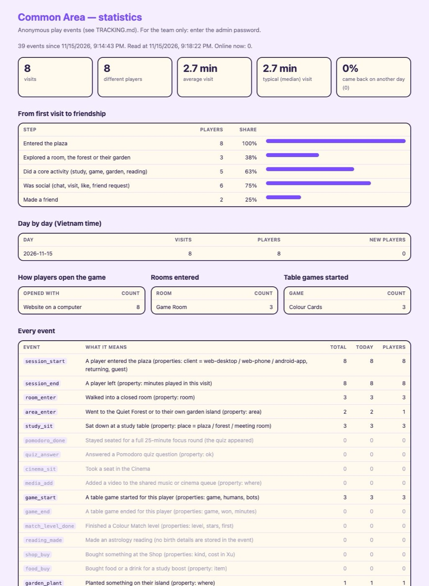

# Common Area — tracking plan

What we track in the game, what each event measures, and why it matters for the product.
Everything listed here is built and running on the online game; nothing in this file is a wish list.

## What we want to learn

Common Area is a shared online plaza where a class or a group of friends study, play and hang out together. The product works if people **come in, find something to do together, and come back**. The tracking answers five questions:

| Question | Metric | Events used |
|---|---|---|
| Do people arrive, and from where? | Visits and different players per day; share per client (website on a computer, website on a phone, Android app) | `session_start` |
| Do new players get past the plaza? (activation) | Share of players who explore a room / the forest / their garden, and who then do a core activity | `room_enter`, `area_enter`, `study_sit`, `game_start`, `match_level_done`, `garden_plant`, `reading_made` |
| Which features earn their place? | Count and number of players per feature | every feature event below |
| Is it social, or do people play alone? | Share of players who chat, visit, like or send a friend request; friendships made | `chat_sent`, `garden_visit`, `garden_like`, `friend_request`, `friend_accept` |
| Do they stay and come back? (retention) | Average and median visit length; share of players seen on two or more different days | `session_end`, `session_start` |

**North-star number:** players per week who do at least one core activity (study at a table, play a table game, tend their garden or make a reading). Visits alone can be inflated by people who open the link and leave.

## The events

One row per event. "Players" always means different players (see "How it works").

### Visits

| Event | Fires when | Properties | What it measures | Why it matters |
|---|---|---|---|---|
| `session_start` | a player enters the plaza | `client`, `returning`, `guest` | visits, different players, new versus returning players, and which channel they used | The top of the funnel. `client` shows whether the website or the Android app brings people in, so we know which launch channel to push. |
| `session_end` | a player leaves or loses the connection | `minutes` | how long a visit lasts | A study space should hold people for a whole study round (25 minutes or more). Short visits mean the first minutes are not convincing. |

### Finding your way

| Event | Fires when | Properties | What it measures | Why it matters |
|---|---|---|---|---|
| `room_enter` | a player walks into a closed room | `room` | which rooms are found and used | Rooms are the main features. A room nobody enters needs a better entrance, or should be removed, as we did with the Garden Room. |
| `area_enter` | a player goes to the Quiet Forest or to their own garden island | `area` | use of the two areas outside the plaza | Shows whether players discover the forest gate and the My Garden button without being told. |

### Studying

| Event | Fires when | Properties | What it measures | Why it matters |
|---|---|---|---|---|
| `study_sit` | a player sits down at a study table | `place` (plaza, forest, meeting room) | how many players start a study session, and where | Studying together is the product's core promise. This is the first step of that loop. |
| `pomodoro_done` | a seated player completes 25 focused minutes (the quiz appears) | none | completed focus rounds | The real proof of value: the player actually studied here. Compared with `study_sit` it gives the completion rate. |
| `quiz_answer` | a player answers a quiz question | `ok` | quiz take-up and how hard the questions are | If most answers are wrong, or nobody answers, the quiz bank needs work. |

### Playing and watching together

| Event | Fires when | Properties | What it measures | Why it matters |
|---|---|---|---|---|
| `game_start` | a table game starts (once per human player at the table) | `game`, `humans`, `bots` | which games are played, and whether with real people or computer players | The Game Room is built for shared tables. Many games with `humans: 1` would mean people cannot find partners. |
| `game_end` | a table game ends (once per human player) | `game`, `won`, `minutes` | games finished and how long they take | Started-but-not-finished games point to games that are too long (our Ludo is a suspect). |
| `match_level_done` | a player finishes a Colour Match level | `level`, `stars`, `first` | progress in the single-player game | Shows where the level curve loses players. |
| `cinema_sit` | a player takes a cinema seat | none | cinema audience | Tells us whether the cinema is used at all. |
| `media_add` | a player adds a video to the music or cinema queue | `where` | use of shared music and films | Shared media is a reason to stay in the room together. |
| `reading_made` | a player makes an astrology reading | none (no birth details) | use of the Astrology Room | The room took the most writing effort; this shows whether it pays off. |

### Garden and economy

| Event | Fires when | Properties | What it measures | Why it matters |
|---|---|---|---|---|
| `shop_buy` | a player buys something at the Shop | `kind`, `cost` | what Xu is spent on | Xu is earned by studying. If nobody spends it, the reward has no pull. This is also where a paid cosmetic shop would start. |
| `food_buy` | a player buys food or a drink | `item` | use of study boosts | Checks whether the boost is understood and worth its price. |
| `garden_plant` | a player plants something on their island | `where` | players who start gardening | The garden is the long-term reason to come back tomorrow. |
| `garden_harvest` | a player harvests | `where` | players who complete a growing cycle | Planting without harvesting means players did not return in time. |
| `fish_caught` | a player lands a fish | `tier` | use of the fishing mini-game | Shows whether the forest's main activity is found and finished. |

### Social

| Event | Fires when | Properties | What it measures | Why it matters |
|---|---|---|---|---|
| `chat_sent` | a player sends a chat message | `channel` (all, forest, table). The text is never stored. | how talkative the space is | A plaza where nobody talks is a single-player game. |
| `friend_request` | a player asks another to be friends | none | attempts to connect | The start of the social graph. |
| `friend_accept` | two players become friends | `with` (the other player's made-up id) | friendships made | Players with friends have a reason to return. This is the last step of our funnel. |
| `friend_remove` | a player removes a friend | none | friendships ended | A safety signal next to `report_filed`. |
| `garden_visit` | a player visits someone else's garden | `kind` (friend, player, villager) | visiting, and whether the friends list drives it | Shows whether the friends feature leads to visits. |
| `garden_like` | a player likes a garden | none | appreciation between players | Likes pay the owner Xu, so this is our lightest social reward loop. |
| `report_filed` | a player reports another player | none | trouble between players | An early warning that moderation tools are needed. |

## How it works

- **Where:** the rules call `Room.prototype.ev` in `public/shared/room.js` (and `track` in `games.js` / `roomplugins.js`) at the moment something really happens, after the server has accepted it. A browser cannot fake an event by claiming it.
- **Storage:** `tracking.mjs` keeps events in memory and appends them to `data/events.jsonl` (one JSON object per line). `data/` is never committed.
- **Reading the numbers:** open `/stats.html` on the game server and enter the admin password. The page shows visits, players, visit length, the funnel from first visit to friendship, a day-by-day table, and a row for every event. "Save these numbers as a file" downloads them as JSON.
- **Solo mode and computer players are not tracked.** Only the online game (`server.mjs`) counts.

*The stats page on a test server, after the scripted run that recorded the demo video (8 scripted players, so the numbers are not real usage).*

### Privacy

- An event holds a time, the event name, a few properties from the tables above, and two ids. There are **no names, no chat text, no birth details and no IP addresses**.
- `s` is the random id of one visit. `u` is the player's garden id: a short code worked out from the random token the browser keeps, so "the same player came back" can be counted without knowing who the player is. Players who have no saved profile have no `u`.
- The start screen tells players that anonymous play events are counted.

## Limits

- **The free hosting plan forgets.** On Render's free plan the event file is wiped whenever the server sleeps, restarts or is redeployed, so today the numbers cover one server lifetime. Retention across weeks needs the paid disk (`DATA_DIR`) or an outside analytics service.
- **One player can be several ids.** A player who uses both the website and the Android app, or clears their browser data, is counted as different players.
- **A visit that ends with the server** (restart) has no `session_end`.
- Day boundaries use Vietnam time (UTC+7).

## Adding an event

1. Call `this.ev(player, 'event_name', { property: value })` in the rule that accepts the action.
2. Add the event to `EVENTS` in `tracking.mjs` and a row to this file. `node tests/tracking.test.mjs` fails if the code and this file disagree.
